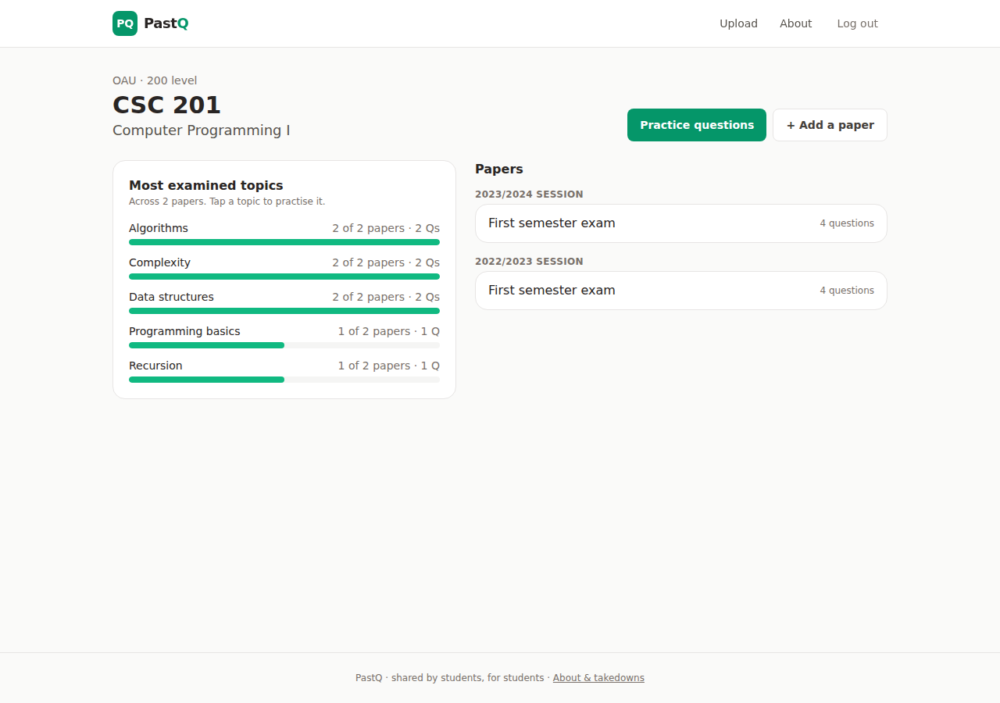
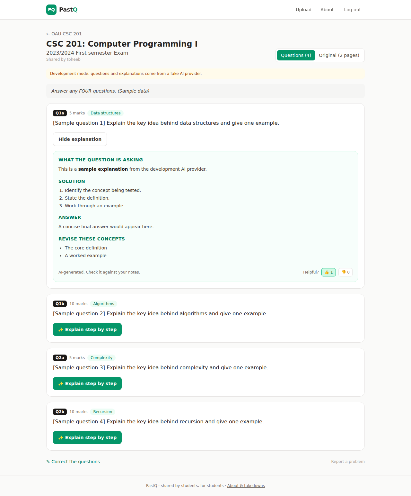

# PastQ 📝

**Past questions for Nigerian university courses, read by AI, explained step by step, and ranked by the topics that come up most.**


Past questions usually live as blurry photos in WhatsApp groups. On PastQ, students upload photos or a PDF of a paper. AI reads it into separate questions tagged by topic, and then anyone can:

- **browse papers by course and session** (OAU, UI, UNILAG and more)
- **get a step-by-step explanation** of any question. It's generated once and shared with everyone, and readers rate whether it helped.
- **see the most examined topics**, e.g. "Recursion: 5 of 6 papers", so they know where to focus
- **practise**: shuffled questions from past papers, optionally by topic

<!-- Replace with your live URL once deployed:
**Live:** https://pastq-xxxx.onrender.com
-->

| Course page | Paper with an explanation |
|---|---|
|  |  |

<sub>Screenshots use the development AI provider's sample output.</sub>

## How it works

1. **Upload.** Photos from a phone or a PDF (up to 12 pages). PDFs are rendered to images with `pypdfium2`. Every page is rotated upright from EXIF data, resized to at most 1800 px, and saved as JPEG. That keeps storage small and pages quick to load on mobile data.
2. **Read.** A background job sends the page images to a vision-capable AI model. The model returns structured JSON: question number, exact text, marks and a short topic. The course's existing topics are passed in, so "Linked lists" doesn't become three different spellings. The uploader can then correct any question.
3. **Explain.** The first person to ask for an explanation triggers one AI call. The answer is stored and served to everyone after that, so popular questions cost nothing. New explanations are limited per user per day. Cached ones are always free.
4. **Rank topics.** Course pages count how many *papers* each topic appears in, across years.

Without an AI key the app still works: uploaders type the questions in, and explanations are hidden.

## Engineering highlights

- **Provider-agnostic AI layer** ([`papers/ai.py`](backend/papers/ai.py)): one `complete()` call for any OpenAI-compatible API (Google Gemini's free tier, Groq, OpenAI) or Anthropic's Messages API. It parses JSON defensively (code fences, extra sentences) and turns provider failures into friendly messages. A clearly labelled **fake provider** makes local development and tests deterministic.
- **Safe rendering of AI output:** Markdown goes through `marked` and then `DOMPurify`, tested against script and `onerror` injection.
- **Object storage done right:** a private S3-compatible bucket (Backblaze B2's free 10 GB works) served through time-limited signed URLs. A test runs the whole upload → AI read → signed URL path against a mocked S3 (`moto`), and the end-to-end run used a local S3 server.
- **Edits keep work:** correcting one question keeps the stored explanations of the questions you didn't change.
- **Moderation:** users can report a paper, and moderators hide it in the Django admin. Hidden papers disappear from search, topics and practice, but the uploader can still see them.
- **Tested:** 49 backend tests (uploads, PDFs, limits, AI transports, caching, votes, storage) run on PostgreSQL in CI, plus frontend tests.

## Tech

| Layer | Tech |
|---|---|
| Backend | Django 5.2, Django REST Framework, JWT auth, PostgreSQL |
| AI | Gemini (OpenAI-compatible endpoint) or Anthropic, vision input, JSON output |
| Files | Pillow, pypdfium2, django-storages + S3-compatible storage |
| Frontend | React 18, React Router, Vite, Tailwind CSS v4, marked + DOMPurify |
| Testing | pytest, responses, moto, Vitest (jsdom) |
| DevOps | GitHub Actions (PostgreSQL), Docker Compose, Render + Neon + Backblaze B2 |

## Run it locally

```bash
cd backend
python -m venv venv
source venv/Scripts/activate        # macOS/Linux: source venv/bin/activate
pip install -r requirements.txt
python manage.py migrate
python manage.py seed_universities
AI_PROVIDER=fake python manage.py runserver   # fake AI; or set AI_PROVIDER/AI_API_KEY for real
```

```bash
cd frontend
npm install
npm run dev                          # http://localhost:5173
```

Files are stored in `backend/media/` locally. Tests: `cd backend && pytest` and `cd frontend && npm test`.

## Deploy (all free tiers)

1. **Database:** create a Neon project and copy the connection string.
2. **Storage:** create a private bucket in Backblaze B2 and an application key with access to it. Note the bucket's S3 endpoint (e.g. `https://s3.us-west-004.backblazeb2.com`) and region (`us-west-004`).
3. **AI:** create a free API key in Google AI Studio. Check AI Studio for the current Flash model name and set it as `AI_MODEL` if it differs from the default.
4. **Render:** choose **New → Blueprint**, pick this repo, and fill in `DATABASE_URL`, the five `S3_*` values and `AI_API_KEY`.

| Variable | Purpose |
|---|---|
| `DATABASE_URL` | PostgreSQL connection string |
| `S3_BUCKET`, `S3_ENDPOINT_URL`, `S3_REGION`, `S3_ACCESS_KEY_ID`, `S3_SECRET_ACCESS_KEY` | Where page images are stored |
| `AI_PROVIDER` | `openai` (any OpenAI-compatible API), `anthropic`, `fake` (development only) or empty (AI off) |
| `AI_API_KEY`, `AI_MODEL`, `AI_BASE_URL` | Provider settings. `AI_BASE_URL` defaults to Gemini's OpenAI-compatible endpoint |
| `EXPLANATIONS_PER_USER_PER_DAY`, `UPLOADS_PER_USER_PER_DAY` | Limits (defaults 30 and 15) |

To moderate, create an admin with `python manage.py createsuperuser` (locally, pointed at the production database), then use `/admin/` to hide papers and resolve reports.

## Growth plan

- **Seed one department first.** Upload your own set's papers for 5–10 core courses before sharing, so the first visitors find something useful.
- **Share course links in class groups** before exams, e.g. "All CSC 201 past questions, with explanations".
- **Recognise contributors.** Uploaders are credited on their papers and on the home page leaderboard.

## Roadmap

- [ ] Search inside question text across all papers
- [ ] AI-generated practice questions in the style of past papers
- [ ] Class rep / moderator roles per department
- [ ] Offline reading (PWA) for students on patchy data
- [ ] Explanations with diagrams and LaTeX rendering

## Author

**Toheeb Olatunde**, Computer Science, Obafemi Awolowo University
GitHub: [@Horrly](https://github.com/Horrly)
